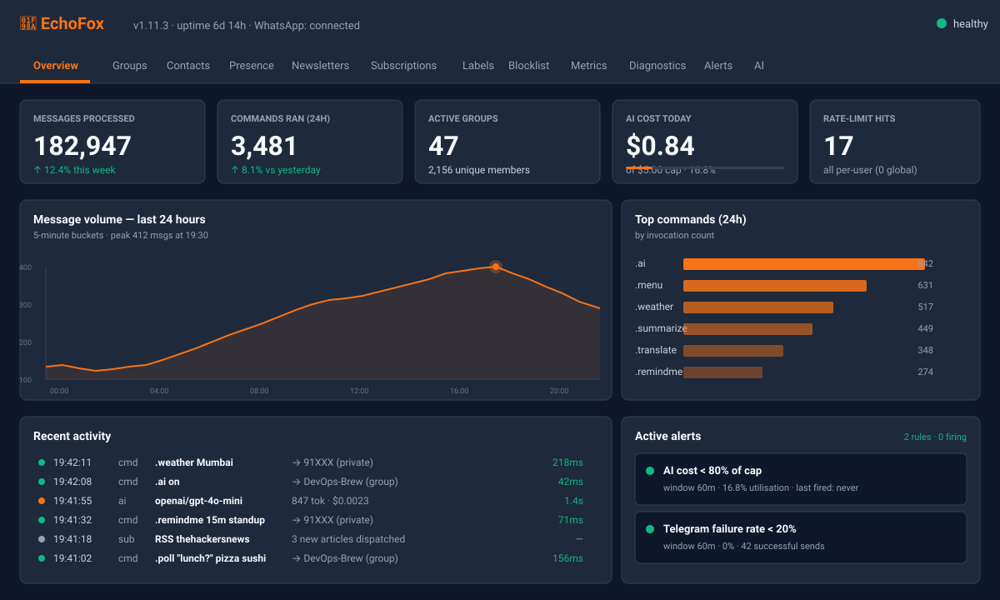

# 🦊 EchoFox

> A WhatsApp bot built on **[Baileys 7.x](https://github.com/WhiskeySockets/Baileys)** — configurable, observable, and friendly to extend.

[](https://www.gnu.org/licenses/agpl-3.0)
[](https://nodejs.org/)
[](https://www.npmjs.com/package/@whiskeysockets/baileys)
[](https://www.npmjs.com/package/echofox)
[](https://hub.docker.com/r/cosm1cbug/echofox)
[](https://github.com/Cosm1cBug/EchoFox/pkgs/container/echofox)
[](https://github.com/Cosm1cBug/EchoFox/actions/workflows/ci.yml)
[](https://github.com/Cosm1cBug/EchoFox/actions/workflows/docs.yml)

> ⚠️ **Please read [DISCLAIMER.md](./DISCLAIMER.md) before using.** Running an unofficial WhatsApp client may violate WhatsApp's Terms of Service and can result in your number being banned. Use a number you can afford to lose.

---

[](https://gitdiagram.com/cosm1cbug/echofox?utm_source=readme&utm_medium=badge)

## ✨ Features

### Core

- 🔌 **Baileys 7.x** with the recommended retry, group-metadata, and signal-key caches wired in
- 🧩 **Folder-based command registry** with hot-reload, alias resolution, and auto-skip of commands missing API keys
- 📦 **Pluggable store backend** — SQLite (default), Postgres, MongoDB, or Redis
- 🔑 **Pluggable auth backend** — multi-file (default), Redis, or SQLite
- 🆔 **Login via QR or pairing code**
- 📊 **Built-in web dashboard** at `:3001/dashboard` (React-based, with live stats + 11 tabs)
- 🚦 **Per-chat queue** for back-pressure
- ❤️ **Health & metrics** at `GET /healthz` and `GET /metrics` (Prometheus)
- 📝 **Structured logging** via Pino
- 🛡️ **Built-in middleware** for rate-limiting and concurrency control
- 🔄 **Supervisor + worker** model with exponential-backoff restart
- 🌐 **Dual prefix** — `.` for users, `$` for admins
- 🧪 **Zod-validated config** with legacy support

### AI service

- 🤖 **4 LLM providers** out of the box: **OpenAI**, **Google Gemini**, **Anthropic Claude**, and **local Ollama**
- 🛠️ **12 intel-focused tools** — VirusTotal, AlienVault OTX, GitHub releases/advisories, Wikipedia, SSRF-guarded `fetch_url`, plus 5 read-only WhatsApp store queries
- 🎭 **Personas** — `threat-intel` (default, security-focused) / `general` / `custom`
- 🧠 **20-turn rolling memory** per chat, persisted across restarts
- ✋ **Per-chat opt-in** — no surprise replies; users explicitly enable with `.ai on`
- 💰 **Hard daily USD cost cap** with per-provider pricing table; rate limits **30/user/hour** + **100/chat/day**

### Telegram log bridge

- 📡 **Outbound-only** mirror of WhatsApp log channels (`syslogs`, `botLogs`, `errLogs`, …) to Telegram chats/channels
- 🔌 **Zero new dependencies** — raw HTTPS to `api.telegram.org` over the existing circuit-breaker
- ⚡ **2-second batching** for info-level logs; `error`/`fatal` flushes **immediately**
- 🎯 **Per-channel routing** — different WhatsApp log channels can go to different Telegram destinations
- 💾 **Persistent AI rate-limit counters** (v1.3.0) survive bot restarts

### Ops polish

- 🚀 **CI/CD auto-release** — `git push origin v1.x.x` triggers GitHub Release + Docker (GHCR + Docker Hub, multi-arch) + npm publish (with provenance) + Pages deploy in parallel
- 📚 **VitePress docs site** auto-deployed to [cosm1cbug.github.io/echofox](https://cosm1cbug.github.io/EchoFox/)
- 📊 **22 Grafana panels** out of the box (defaults + AI + Telegram + Signal Protocol Health)
- 🚨 **2 built-in alert rules**: AI cost > 80% of cap, Telegram failure rate > 20% — mirrored to both WhatsApp `errLogs` AND Telegram
- 🩹 **Signal protocol self-healing** (v1.4.2) — auto-recovers from `Bad MAC` / `No session found` decryption errors without operator intervention; demotes the noisy ERROR logs to DEBUG

---

## 🚀 Quick start

### Prerequisites

|          |                                                                                                                                          |
| -------- | ---------------------------------------------------------------------------------------------------------------------------------------- |
| Node.js  | ≥ 22.12 — Baileys 7.x is ESM-only and is loaded via `require()`; unflagged `require(esm)` landed in Node 22.12 (and 20.19). CI: Node 22. |
| OS       | Linux / macOS / Windows 11                                                                                                               |
| WhatsApp | A real phone number you can scan a QR / pairing code from                                                                                |

### Install

EchoFox can be installed three ways. **The hardening changes on this branch are unreleased**; older npm packages/images do not necessarily contain them. Review [remediation status](./docs/REMEDIATION_STATUS.md) and the [operator runbook](./docs/HARDENING_RUNBOOK.md). There is no measured production-capacity claim, and release remains blocked by the license inconsistency described there.

#### ⚡ Option A — npm package _(verify the release first)_

```bash
mkdir my-echofox && cd my-echofox
npm init -y
npm install echofox
# These CLI commands require a package containing this revision.
# If unavailable in your installed release, use the source checkout instead.
npx echofox --version
cp node_modules/echofox/src/config.example.js ./echofox.config.cjs
# Edit the external config, then validate without starting WhatsApp:
npx echofox config:check --config ./echofox.config.cjs
npx echofox start --config ./echofox.config.cjs
```

Keep credential-bearing configuration outside version control and restrict its permissions.

Latest published version: **[](https://www.npmjs.com/package/echofox)**

#### 🐳 Option B — Docker image _(zero-Node-install, multi-arch)_

```bash
docker pull ghcr.io/cosm1cbug/echofox:latest
# For production, select a verified immutable digest containing your fixes.
# An existing `latest` image is not evidence these unreleased changes are present.
```

Then run with your config mounted in (see [Docker](#-docker) section below).

#### 🛠️ Option C — Clone from source _(for hacking on the bot itself)_

```bash
git clone https://github.com/Cosm1cBug/EchoFox.git
cd EchoFox
npm ci
```

### Configure (source checkout)

```bash
cp src/config.example.js src/config.js
# Edit src/config.js with your details
```

At minimum set:

- `admins[]` — your own JID (e.g. `1234567890@s.whatsapp.net`)
- `bot.timezone` — your IANA timezone

Use an external private file via `ECHOFOX_CONFIG` when appropriate. Inspect the defaults before enabling features; flags now survive normalization and may activate previously dormant code. See [Configuration reference](#%EF%B8%8F-configuration-reference) below.

### Run (source checkout)

```bash
npm run config:check
npm run build:dashboard
npm start
```

On first run you'll see a QR code in the terminal. Open WhatsApp on your phone → **Settings → Linked Devices → Link a Device → scan it**.

Alternatively, pairing code:

```js
// src/config.js
login: { type: 'PAIRING', phoneNumber: '1234567890' }
```

Then `npm start` prints an 8-character code; enter it on your phone in the same Linked Devices flow.

---

## 🖥️ Dashboard

The bot ships a React-based web dashboard at `:3001/dashboard` with **12 tabs** covering everything the bot tracks.

<p align="center">
  <a href="./.github/assets/dashboard.svg">
    
  </a>
</p>

The tabs:

| Tab           | Shows                                                              |
| ------------- | ------------------------------------------------------------------ |
| Overview      | uptime, throughput, current load                                   |
| Groups        | groups the bot is in + per-group activity                          |
| Contacts      | known contacts with extended status                                |
| Presence      | recently-active users with state icons                             |
| Newsletters   | WhatsApp channels the bot follows                                  |
| Subscriptions | RSS / AlienVault / VirusTotal subscriptions                        |
| Labels        | WA Business labels                                                 |
| Blocklist     | blocked JIDs                                                       |
| Metrics       | full Prometheus metric snapshot                                    |
| Diagnostics   | self-test report (config, store, auth, network)                    |
| Alerts        | active built-in alert rules                                        |
| **AI**        | config, cost-cap progress bar, per-day usage table, opted-in chats |

### Development

```bash
cd dashboard
npm install
npm run dev          # Vite dev server, hot reload
```

### Production

```bash
cd dashboard
npm run build        # outputs to dashboard/dist/
```

Or let the bot serve the bundled version automatically when `dashboard.enabled = true`.

---

## 📦 Built-in commands

Run `.menu` in WhatsApp to see the live list — 30+ commands across `general`, `download`, `convert`, `group`, `admin`, `misc`, `main`, `tools`, `user`.

Highlights:

| Category     | Commands                                                                       |
| ------------ | ------------------------------------------------------------------------------ |
| AI (v1.2.0+) | `.ai status` / `on` / `off` / `clear` / `persona` / `provider` / `model`       |
| Intel        | `.virustotal`, `.alienvault`, `.thehackersnews`, `.rss`, `.github`, `.vtwatch` |
| Download     | `.song`, `.video`, `.mediafire`, …                                             |
| Convert      | `.sticker`, `.toimg`, `.tts`                                                   |
| Group        | `.add`, `.kick`, `.promote`, `.demote`, `.link`, `.approve`, …                 |
| Admin (`$`)  | `$healthcheck`, `$serverinfo`, `$ai-admin stats`, …                            |

See [`docs/commands.md`](./docs/commands.md) for the full auto-generated catalogue.

---

## 🤖 AI service

Set in `src/config.js`:

```js
ai: {
  enabled:          true,
  defaultProvider:  'openai',          // openai | gemini | anthropic | local
  model:            'gpt-4o-mini',
  costCapPerDayUsd: 5,
  providers: {
    openai: { apiKey: process.env.OPENAI_API_KEY },
  },
},
```

Then in any chat:

```
.ai on
hey echofox, what's the latest on log4j
```

The bot routes to the selected provider, chains tools (e.g. `github_advisories` + `latest_hackernews` + `wiki_lookup`), cites sources, and stays under your daily cap. Full guide: [`docs/guide/ai.md`](./docs/guide/ai.md) or [the docs site](https://cosm1cbug.github.io/echofox/guide/ai).

---

## 📡 Telegram log bridge

Mirror WhatsApp log channels to Telegram with per-channel routing — outbound-only, no Telegram polling.

```js
telegram: {
  enabled:   true,
  botToken:  process.env.TELEGRAM_BOT_TOKEN,
  routing: {
    syslogs: '@echofox_sys',          // public channel handle
    errLogs: '-1001234567890',        // private group numeric id
    // empty string disables that channel's mirror
  },
  parseMode: 'HTML',
  batchMs:   2000,                    // errors flush instantly
},
```

Full guide: [`docs/guide/telegram.md`](./docs/guide/telegram.md) or [the docs site](https://cosm1cbug.github.io/echofox/guide/telegram).

---

## 🏗️ Architecture

```
                ┌─────────────┐
                │bootstrap.js │  ← supervisor (PM2-like; restarts on crash)
                │:3000/healthz│
                │:3000/metrics│
                └──────┬──────┘
                       │ fork()
                ┌────────▼──────┐
                │  worker.js    │  ← single Baileys socket
                │:3001/dashboard│  ← (when enabled)
                │:3001/metrics  │  ← (store-backed counters)
                └──────┬────────┘
        ┌──────────────┼──────────────────┐
        │              │                  │
   ┌────▼────┐   ┌─────▼─────┐   ┌────────▼────────┐
   │ events/ │   │ commands/ │   │  services/      │
   │ (28)    │   │ (32)      │   │  ai, telegram,  │
   │         │   │           │   │  alertEngine,   │
   │         │   │           │   │  signalHealth,  │
   │         │   │           │   │  metrics, …     │
   └─────────┘   └───────────┘   └─────────────────┘
                                 │
                          ┌──────▼──────┐
                          │  store/     │  SQLite | Postgres | Mongo | Redis
                          │  migrations │
                          └─────────────┘
```

---

## ⚙️ Configuration reference

Edit `src/config.js`. Every field has a sensible default; you can leave most empty.

### Core sections

| Path                    | Type           | Default              | Description                                         |
| ----------------------- | -------------- | -------------------- | --------------------------------------------------- |
| `bot.name`              | string         | `"EchoFox"`          | Bot display name                                    |
| `bot.prefix`            | string\|RegExp | `"."`                | User-command prefix                                 |
| `bot.adminPrefix`       | string\|RegExp | `"$"`                | Admin-command prefix                                |
| `bot.sessionName`       | string         | `"@session"`         | Folder name for WA auth files                       |
| `bot.timezone`          | string         | `"Asia/Kolkata"`     | IANA timezone for logs / scheduling                 |
| `bot.public`            | boolean        | `true`               | `false` = admin-only mode                           |
| `features.readMessages` | boolean        | `true`               | Mark incoming msgs as read                          |
| `features.readStatus`   | boolean        | `true`               | Mark statuses as read                               |
| `features.antiCall`     | boolean        | `false`              | Auto-reject incoming calls                          |
| `features.syncHistory`  | boolean        | `true`               | Pull full history on first login                    |
| `login.type`            | enum           | `"QR"`               | `"QR"` or `"PAIRING"`                               |
| `login.phoneNumber`     | string         | `""`                 | Required if `type="PAIRING"` (digits only)          |
| `auth.method`           | enum           | `"MULTIFILE"`        | `"MULTIFILE"` / `"REDIS"` / `"SQLITE"`              |
| `storeDB.type`          | enum           | `"SQLITE"`           | `"SQLITE"` / `"POSTGRES"` / `"MONGODB"` / `"REDIS"` |
| `dashboard.enabled`     | boolean        | `false`              | Built-in web UI                                     |
| `dashboard.port`        | number         | `3001`               |                                                     |
| `dashboard.password`    | string         | `"change-me-please"` | ⚠️ change this                                      |

### AI section

| Path                            | Type    | Default                    | Description                                     |
| ------------------------------- | ------- | -------------------------- | ----------------------------------------------- |
| `ai.enabled`                    | boolean | `false`                    | Master switch                                   |
| `ai.defaultProvider`            | enum    | `'openai'`                 | `openai` / `gemini` / `anthropic` / `local`     |
| `ai.model`                      | string  | `'gpt-4o-mini'`            | Provider-specific model name                    |
| `ai.maxTokens`                  | number  | `800`                      | Per-response token cap                          |
| `ai.costCapPerDayUsd`           | number  | `5`                        | Hard daily cap — bot refuses to reply past this |
| `ai.persona`                    | enum    | `'threat-intel'`           | `threat-intel` / `general` / `custom`           |
| `ai.memoryTurns`                | number  | `20`                       | Rolling memory window (10 user + 10 assistant)  |
| `ai.optInDefault`               | enum    | `'off'`                    | `'on'` to auto-enable in every chat             |
| `ai.rateLimitPerUserPerHour`    | number  | `30`                       |                                                 |
| `ai.rateLimitPerChatPerDay`     | number  | `100`                      |                                                 |
| `ai.enableToolCalling`          | boolean | `true`                     |                                                 |
| `ai.toolWhitelist[]`            | array   | 12 tools                   | Which intel tools the model can call            |
| `ai.providers.openai.apiKey`    | string  | `''`                       |                                                 |
| `ai.providers.gemini.apiKey`    | string  | `''`                       |                                                 |
| `ai.providers.anthropic.apiKey` | string  | `''`                       |                                                 |
| `ai.providers.local.baseUrl`    | string  | `'http://localhost:11434'` | Ollama endpoint                                 |

### Telegram section

| Path                                                                                 | Type    | Default  | Description                                       |
| ------------------------------------------------------------------------------------ | ------- | -------- | ------------------------------------------------- |
| `telegram.enabled`                                                                   | boolean | `false`  |                                                   |
| `telegram.botToken`                                                                  | string  | `''`     | from @BotFather                                   |
| `telegram.routing.{syslogs,botLogs,userLogs,groupUpdates,callLogs,errLogs,movGroup}` | string  | `''`     | Telegram chat id or `@channel` per WA log channel |
| `telegram.parseMode`                                                                 | enum    | `'HTML'` | `HTML` / `MarkdownV2` / `plain`                   |
| `telegram.batchMs`                                                                   | number  | `2000`   | Errors flush instantly regardless                 |
| `telegram.maxChunkChars`                                                             | number  | `3800`   | Telegram cap is 4096                              |

### Alerts section

| Path                               | Type    | Default                                                | Description                                          |
| ---------------------------------- | ------- | ------------------------------------------------------ | ---------------------------------------------------- |
| `alerts.enabled`                   | boolean | `true`                                                 |                                                      |
| `alerts.windowMinutes`             | number  | `60`                                                   | rolling window                                       |
| `alerts.minInvocations`            | number  | `10`                                                   | need at least N runs to alert                        |
| `alerts.failureRateThreshold`      | number  | `0.30`                                                 | per-command failure rate trigger                     |
| `alerts.rules.aiCostPct`           | object  | `{threshold: 0.80, cooldownMinutes: 60}`               | Fire when daily AI cost reaches this fraction of cap |
| `alerts.rules.telegramFailureRate` | object  | `{threshold: 0.20, minSends: 10, cooldownMinutes: 30}` | Fire when Telegram send-failure rate is high         |

Every field can also be set via an environment variable:
`ECHOFOX_<SECTION>_<CAMELCASEKEY>` — e.g. `ECHOFOX_APIS_OMDB_APIKEY=xyz`, `ECHOFOX_STOREDB_TYPE=POSTGRES`.

Full configuration guide: [`docs/config.md`](./docs/config.md).

---

## ✍️ Writing your own commands

See [CONTRIBUTING.md](./CONTRIBUTING.md). TL;DR: drop a `.js` file in `src/commands/<category>/`:

```js
module.exports = {
  name: 'hello',
  alias: ['hi'],
  desc: 'Says hello',
  category: 'general',
  cooldown: 3,
  async start(sock, m, { ctx, args, text, config }) {
    await ctx.reply(`Hello ${ctx.pushName || 'friend'}!`);
  },
};
```

Hot reload picks it up immediately. The contract test (`npm test`) verifies every command's shape and detects name/alias collisions across the whole tree.

---

## 📊 Observability

```bash
curl http://localhost:3000/healthz       # supervisor health
curl http://localhost:3000/metrics       # supervisor + Node.js defaults
curl http://localhost:3001/metrics       # store-backed counters
```

Prometheus metrics exposed (28 counters + 9 gauges across 2 endpoints):

| Endpoint | Metric                                     | Type    | Description                    |
| -------- | ------------------------------------------ | ------- | ------------------------------ |
| `:3000`  | `echofox_worker_up`                        | gauge   | 1 if the worker is alive       |
| `:3000`  | `echofox_worker_restarts_total`            | counter | Cumulative supervisor restarts |
| `:3001`  | `echofox_messages_received_total`          | counter | Inbound messages               |
| `:3001`  | `echofox_commands_total`                   | counter | Command invocations            |
| `:3001`  | `echofox_ai_chat_requests_total`           | counter | AI chat requests               |
| `:3001`  | `echofox_ai_tokens_prompt_total`           | counter | Prompt tokens consumed         |
| `:3001`  | `echofox_ai_tokens_completion_total`       | counter | Completion tokens consumed     |
| `:3001`  | `echofox_ai_cost_usd_today`                | gauge   | Today's AI spend               |
| `:3001`  | `echofox_telegram_forwards_total`          | counter | Telegram log forwards          |
| `:3001`  | `echofox_telegram_send_failures_total`     | counter | Telegram send failures         |
| `:3001`  | `echofox_signal_decryption_failures_total` | counter | Baileys decryption errors      |
| `:3001`  | `echofox_signal_session_recoveries_total`  | counter | Auto-triggered session resets  |

…plus 18 more. Full list at `src/store/schema/stats.js`.

**Grafana dashboard JSON**: `docker/grafana/dashboards/echofox-overview.json` — 22 panels organised in 3 sections (core process metrics, AI v1.2+, Telegram v1.3+, Signal Protocol Health v1.4.2+). Auto-provisioned by the Compose `observability` profile.

---

## 🐳 Docker

### One-liner

```bash
docker run -d --name echofox \
  -p 3000:3000 -p 3001:3001 \
  -v echofox-data:/app/src/store/runtime \
  -v echofox-session:/app/src/@session \
  -e ECHOFOX_BOT_TIMEZONE=Asia/Kolkata \
  cosm1cbug/echofox:latest
```

Tag scheme:

- `:1.4.2`, `:1.3.0`, etc. — precise (immutable)
- `:1.4`, `:1.3`, `:1.2` — major.minor (auto-updates with patches)
- `:latest` — always newest stable
- `:sha-abc1234` — per-commit immutable tag

Available on both [GHCR](https://github.com/Cosm1cBug/EchoFox/pkgs/container/echofox) and [Docker Hub](https://hub.docker.com/r/cosm1cbug/echofox).

### Docker Compose

```bash
# Bot only:
docker compose up -d

# With Prometheus + Grafana:
docker compose --profile observability up -d
# → Grafana at http://localhost:3001 (admin / changeme)
```

### Full guides

- [docs/deploy/docker.md](./docs/deploy/docker.md) — single container, env vars, volumes, updates
- [docs/deploy/docker-compose.md](./docs/deploy/docker-compose.md) — Compose + observability profile
- [docs/deploy/podman.md](./docs/deploy/podman.md) — rootless alternative
- [docs/deploy/multi-arch.md](./docs/deploy/multi-arch.md) — building your own multi-arch images
- [docs/deploy/troubleshooting.md](./docs/deploy/troubleshooting.md) — when things go wrong
- [docs/deploy/ci-cd.md](./docs/deploy/ci-cd.md) — the 7 GitHub Actions workflows + release flow

---

## 🚀 Releasing a new version _(maintainers)_

Tag workflows are **gated attempts, not guaranteed publications**. Run `npm run verify`, review the actual artifacts/checks, resolve the license/provenance blocker, and obtain owner authorization before a tag or publication. Do not force a retag, bypass a failing gate, weaken account security, or assume Docker/npm succeeded just because a GitHub Release exists.

The [operator runbook](./docs/HARDENING_RUNBOOK.md) describes artifact checks, remaining environment-dependent acceptance and secret provisioning. [CI/CD details](./docs/deploy/ci-cd.md) are historical background; inspect the current workflow files and actual run results. No remote workflow enablement or release is performed by the remediation itself.

---

## 🤝 Contributing

Pull requests welcome! See [CONTRIBUTING.md](./CONTRIBUTING.md).

CI gates every PR with:

- ESLint + Prettier
- Automated integration/unit/contract tests (run `npm test` for the current count; CI: Node 22)
- AGPL header check (every `.js` file must have one)
- Dashboard TypeScript typecheck
- TruffleHog secret scan

By participating, you agree to behave kindly and constructively.

---

## 🔐 Security

Found a vulnerability? Please report it privately — see [SECURITY.md](./SECURITY.md).

Hardening includes per-chat opt-out, actor-scoped tools, pinned public-URL fetching, budget admission, log redaction and authenticated dashboard mutation protection. Each has explicit limitations: single-process spending reservations, incomplete outbound/privacy inventories, pending lifecycle/cancellation/durable-delivery work and unverified live infrastructure. See [implementation status](./docs/REMEDIATION_STATUS.md); do not infer security, provenance or scheduled rebuild success solely from a badge.

---

## ⭐ Star history

[](https://www.star-history.com/?repos=Cosm1cBug%2FEchoFox&type=date&legend=bottom-right)

If EchoFox is useful to you, please [⭐ star the repo](https://github.com/Cosm1cBug/EchoFox) — it's the cheapest way to say "this is cool, keep going."

---

## 📜 License

Licensed under the [GNU Affero General Public License v3.0 or later](./LICENSE).

In short: if you run a modified version of EchoFox as a service, you must offer the source of your modifications to the users who interact with it over the network. Third-party attributions in [NOTICE](./NOTICE).

---

## 💖 Acknowledgements

- **[Baileys](https://github.com/WhiskeySockets/Baileys)** by @PurpShell and contributors — none of this would exist without their reverse-engineering

---

_EchoFox is not affiliated with WhatsApp or Meta. WhatsApp™ is a trademark of WhatsApp LLC._
